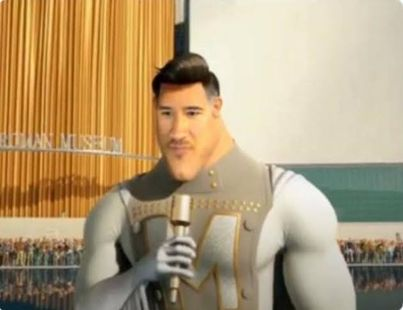
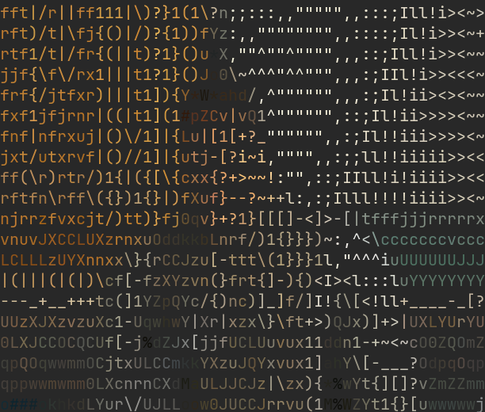
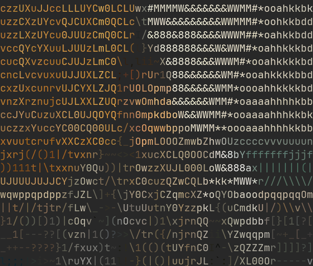

# ASCII Art Converter

A simple C program that converts images to ASCII art with optional color support.

## Example Output

### Original Image



### ASCII Art (Colored, scale: 8)



### ASCII Art (Colored, inverted, scale: 8)



### ASCII ART (Plain Text, scale: 8)

```
fft|/r||ff111|\)?}1(1\?n;;:::,,""""",,:::;Ill!i><~>
rft)/t|\fj{()|/)?{1))fYz:,,"""""""",,::::;Il!i>><~+
rtf1/t|/fr{(||t)?1}()u*X,""^""^"""",,,::;Ill!i>><~~
jjf{\f\/rx1|||t1?1}()Jo0\~^^^"^^""",,,:;IIl!i>><<<~
frf{/jtfxr)|||t1]){Y*W*ahd/,^"""""",,,:;Il!ii><><~~
fxf1jfjrnr|((|t1](1#pZCv|vQ1^"""""",::;Il!ii>>>><~~
fnf|nfrxuj|()\/1]|{Lu|[1[+?_"""""",,:;Il!!iii>>>><~
jxt/utxrvf|()//1]|{utj-[?i~i,"""",,:;;ll!!iiiii>><<
ff(\r)rtr/)1{|({[\{cxx{?+>~~!:"",::;IIll!i!iiii>><<
rftfn\rff\({})1{}|)fXuf}--?~++l:,:;Illl!!!!iiii>><~
njrrzfvxcjt/)tt)}fj0qv}+?1}[[[]-<]>-[|tfffjjjrrrrrx
vnuvJXCCLUXzrnxuOddkkbLnrf/)1{}}})~:,^<\cccccccvccc
LCLLLzUYXnnxx\}{rCCJzu[-ttt\(1}}}1l,"^^^iuUUUUUUJJJ
|(|||(|(|)\cf[-fzXYzvn(}frt{]-){)<I><l:::luYYYYYYYY
---_+__+++tc(]1YZpQYc/{)nc)]_]f/]I!{\[<!ll+____-_[?
UUzXJXzvzuXc1-UqwhwY|Xr|xzx\}\ft+>)QJx)]+>|UXLYUrYU
0LXJCCOCQCUf[-j%dZJx[jjfUCLUuvux11ddn1-+~<~cO0ZQOmZ
qpQOqwwmmOCjtxULCCmkkYXzuJQYxvux1]ahY\[-___?OdpqOqp
qppwwmwmm0LXcnrnCXdMaULJJCJz|\zx){*%wYt{][]?vZmZZmm
o###okhkdLYur\/UJLLoow0JUCCJrrvu(1M%WZYt1{}[uwwwwwj
```

## Features

- Load images in various formats (JPEG, PNG, BMP, GIF, etc.) using `stb_image`
- Convert images to ASCII art using brightness-based character mapping
- Optional 24-bit true color output using ANSI escape codes
- Automatically scales the output to fit the terminal window
- Configurable downsampling for different output sizes
- Inverted mode for dark terminal backgrounds
- Save ASCII art to text files
- Proper aspect ratio handling for terminal display

## Project Structure

```
c/
├── include/                # Header files
│   ├── ascii.h             # ASCII conversion functions
│   └── image.h             # Image structure and loading
├── src/                    # Source files
│   ├── ascii.c             # ASCII conversion implementation
│   ├── image.c             # Image loading and processing
│   └── ascii_art.c         # Main program entry point
├── lib/                    # External libraries
│   └── stb_image.h         # Single-header image loading library
├── examples/               # Example images for testing
│   ├── test_1.jpg
│   ├── test_2.jpg
│   └── test_3.jpg
├── output/                 # Sample outputs
│   └── example_output_test_1.png
├── build/                  # Build artifacts (*.o files)
├── ascii_art               # Compiled executable
├── Makefile                # Build configuration
├── README.md               # This file
├── .gitignore              # Git ignore rules
└── .gitattributes          # Git language recognition tools
```

## Building

### Prerequisites

- GCC (or any C99-compatible compiler)
- Make
- A terminal that supports 24-bit color (optional, for color output)

### Compile

```bash
# Debug build (with debug symbols)
make

# Or explicitly
make debug

# Release build (optimized)
make release

# Clean build artifacts
make clean
```

## Usage

### Basic Usage

```bash
# Display image scaled to fit the terminal (colored)
./ascii_art examples/test_2.jpg

# Specify custom scale factor (higher = smaller output)
./ascii_art examples/test_2.jpg 8

# Disable color output
./ascii_art examples/test_2.jpg 8 --no-color

# Invert brightness (looks better on dark terminal backgrounds)
./ascii_art examples/test_2.jpg 8 --invert

# Save to file (automatically disables color)
./ascii_art examples/test_2.jpg 4 output/result.txt
```

### Command-Line Arguments

```
./ascii_art <image-file> [scale] [output-file] [--no-color] [--invert]

Arguments:
  image-file    : Path to input image (required)
  scale         : Downsampling factor (optional)
                  Default: fit the terminal, or 4 when saving to a file
                  Higher values = smaller output
                  Only needed to override the automatic fit
  output-file   : Save to file instead of printing (optional)
  --no-color    : Disable ANSI color codes (optional)
  --invert      : Map bright pixels to dense characters (optional)
                  Use on dark terminal backgrounds
```

## How It Works

### 1. Image Loading

- Uses `stb_image.h` to load various image formats
- Converts all images to RGB (3 channels)
- Stores pixel data in a simple `Image` structure

### 2. Brightness Calculation

- Converts RGB to grayscale using the luminosity method:
  - `Gray = 0.299*R + 0.587*G + 0.114*B`
- This weights colors based on human eye sensitivity

### 3. ASCII Mapping

- Uses a 70-character palette ordered by visual density
- Darker characters (like `$`, `@`, `#`) for darker areas
- Lighter characters (like `.`, `,`, ` `) for brighter areas
- Maps grayscale values (0-255) to palette indices

### 4. Block Averaging

- Samples multiple pixels per character for better quality
- Averages RGB values within each block
- Reduces noise and improves visual clarity
- Partial blocks at the right and bottom edges are averaged too,
  so no pixels are dropped

### 5. Aspect Ratio Correction

- ASCII characters are ~2x taller than wide
- Samples 2x more vertical pixels to maintain proper proportions
- Prevents stretched/distorted output

### 6. Terminal Fitting

- When no scale is given, reads the terminal size
  (`ioctl(TIOCGWINSZ)` on Linux/macOS, `GetConsoleScreenBufferInfo` on Windows)
- Picks the smallest scale whose output fits both the width and the height,
  leaving room for the info lines and the shell prompt
- Height is usually the limit, since each character covers a block twice as
  tall as it is wide
- Falls back to scale 4 when saving to a file or when output is piped

### 7. Color Output (Optional)

- Uses ANSI 24-bit true color escape codes
- Format: `\033[38;2;R;G;Bm` for each character
- Preserves original image colors while using ASCII shapes

### 8. Inverted Mode (Optional)

- `--invert` flips brightness (`255 - gray`) before picking a character
- Bright areas get dense characters, dark areas fade to sparse ones
- On a dark terminal background, dense characters read as bright, so the
  image no longer looks like a negative

## ASCII Palette

The program uses this palette (70 characters, dark to light):

```
$@B%8&WM#*oahkbdpqwmZO0QLCJUYXzcvunxrjft/\|()1{}[]?-_+~<>i!lI;:,"^`'.
```

Dense/complex characters appear darker, sparse characters appear lighter.
Because it uses very diverse characters, the images tend to look a bit noisy.

## License

This project is for educational purposes. The code itself is provided as-is.

stb_image.h is in the public domain (see file header for details).

## Acknowledgments

- Sean Barrett for stb_image
